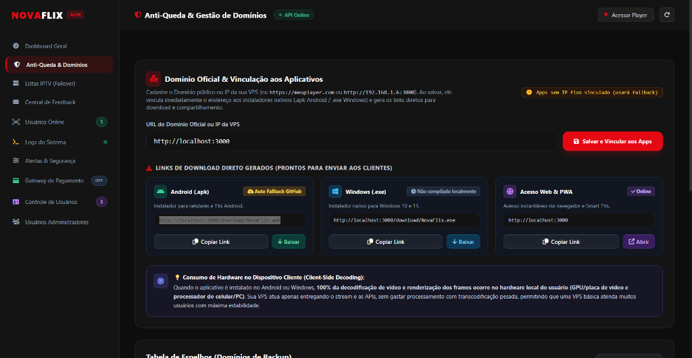
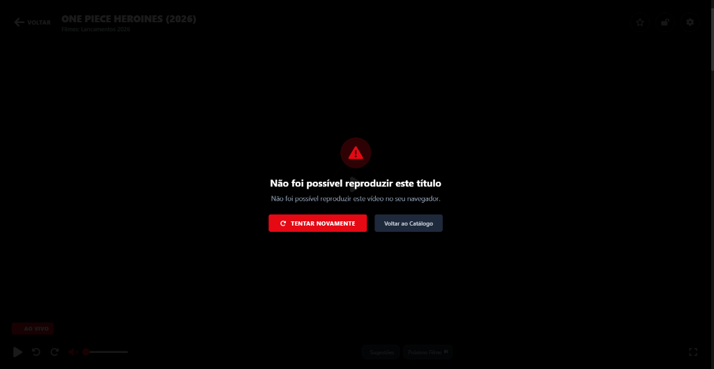
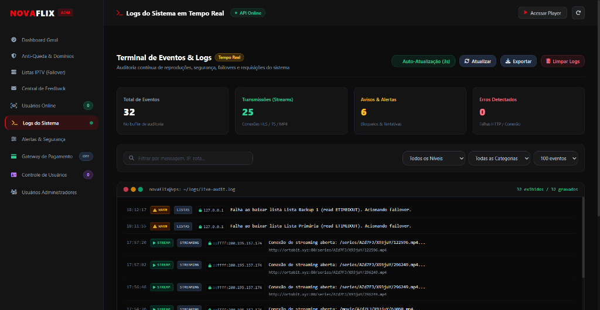

# 🍿 NovaFlix Streaming v2.0.5 — Plataforma VOD (Filmes, Séries & +18) + Painel ADM

Plataforma de streaming web de alta performance com interface estilo **Netflix** (100% responsiva para **PC, TV e Mobile**), otimizada exclusivamente para **Filmes e Séries sob demanda (VOD)** com **Reprodução Automática Instantânea (Autoplay)**, **Controle de Perfis (Kids, Jovem e Adulto +18)** e **Painel Administrativo Soberano (`/admin`)** com **Controle Remoto de Transmissão (Abertura Forçada em Tempo Real)**.

---

## ⚡ Instalação Automática na VPS (1 Comando)

Compatível com **Ubuntu 20.04 / 22.04 / 24.04** e **Debian 11 / 12**. O instalador automático configura **Node.js 22 LTS**, **Memória SWAP de 2GB**, **Google TCP BBR**, **Nginx Proxy Reverso (Porta 80)**, **Firewall UFW** e **PM2 (24/7)**:

```bash
curl -fsSL https://raw.githubusercontent.com/zetra-mini/novaflix/main/deploy-vps.sh | sudo bash
```

Ou clonando manualmente o repositório:
```bash
git clone https://github.com/zetra-mini/novaflix.git /opt/novaflix
cd /opt/novaflix
sudo bash deploy-vps.sh
```

### 🔄 Como Atualizar uma VPS já instalada para a v2.0.5:
```bash
cd /opt/novaflix && git fetch --all && git reset --hard origin/main && rm -f data/catalog_cache.json && pm2 restart all
```

---

## 📸 Demonstração Visual & Telas

| Painel ADM & Gestão de Domínios | Player Web & Autoplay Instantâneo | Terminal de Logs & Diagnóstico em Tempo Real |
| :---: | :---: | :---: |
|  |  |  |
| *Detecção automática de IP da VPS e vinculação instantânea aos instaladores nativos* | *Player cinema com autoplay imediato, suporte a Range Requests MP4 e controles Netflix* | *Auditoria completa de conexões ativas, telemetria de streaming e controle remoto* |

---

## 🌟 O Que Há de Novo na Versão 2.0.5

### 🎬 Catálogo VOD Otimizado (15.969 Filmes + 6.876 Séries)
- **Foco 100% em Filmes e Séries (Zero Travamentos):** Remoção completa de listas de canais ao vivo pesados, deixando o catálogo pré-indexado (`data/catalog_cache.json.gz`) ultrarrápido (< 50ms de resposta).
- **Acervo Completo pré-carregado:**
  - **13.731 Filmes Gerais** (Lançamentos 2026/2025, Qualidade Cinema, Ação, Terror, Comédia, Animação, Ficção, Drama, Nacionais).
  - **6.687 Séries Gerais Únicas** (agrupando **185.505 episódios** organizados por Temporada e Episódio com capas oficiais, sem poluir a busca com episódios soltos).
  - **2.238 Filmes Adultos (+18) & 189 Séries/Coleções Adultas (+18):** Acervo completo liberado no Painel Principal (aba **🔞 Adultos (+18)**, carrosséis e **Ver Tudo**) exclusivamente para perfis maiores de 18 anos, e 100% disponível no **Controle Remoto do ADM**.
- **Busca Inteligente sem Episódios Soltos:** A pesquisa retorna exclusivamente os cards principais de Filmes e Séries (nunca episódios repetidos).

### ▶️ Player com Reprodução Automática Instantânea (Autoplay)
- **Zero Duplo Clique:** Ao clicar em qualquer Filme ou Série, o vídeo inicia automaticamente sem exibir tela intermediária de play travada.
- **Suporte Nativo a MP4 `moov` no Final do Arquivo & Parallel Range Requests:** O proxy de streaming (`/api/stream/:token`) suporta múltiplas conexões `HTTP 206 Partial Content` simultâneas do navegador (Chrome/Safari/Android), permitindo que filmes com índice `moov` grande ou no final do arquivo iniciem imediatamente.
- **Watchdog Inteligente Anti-Stall:** Monitora o buffer somente após o primeiro frame decodificado (`hasStartedPlaying`), evitando abortar o carregamento inicial de cabeçalhos MP4 e recuperando quedas de rede automaticamente.

### 🛡️ Painel Administrativo (`/admin`) & Controle Remoto Soberano
- **Controle Remoto de Transmissão (Abertura Forçada):**
  - Permite selecionar qualquer espectador online (ou transmitir para todos) e forçar a abertura imediata de qualquer conteúdo na tela do cliente.
  - Abas rápidas com listagem completa sem limite de 60 itens: **Todos**, **Filmes**, **Séries**, **🔞 Todos +18 (2.427)**, **🔞 Filmes +18 (2.238)** e **🔞 Séries +18 (189)**.
  - **Seletor de Temporada e Episódio/Cena:** Ao selecionar qualquer Série (geral ou adulta), o ADM pode escolher exatamente qual Temporada e Episódio/Cena disparar.
- **Distribuição de Aplicativos Nativos (`v2.0.5`):**
  - 📱 **Android (`.apk`)**: `/download/NovaFlix.apk`
  - 💻 **Windows (`.exe`)**: `/download/NovaFlix.exe`
  - 🌐 **PWA (Mobile & Desktop)**: Instalação direta pelo navegador sem baixar arquivos.

---

## 🔑 Acesso Padrão após Instalação na VPS

- **Player Web Principal:** `http://IP_DA_VPS` ou `http://IP_DA_VPS:3000`
- **Painel Administrativo (ADM):** `http://IP_DA_VPS/admin` ou `http://IP_DA_VPS:3000/admin`
  - **Usuário padrão:** `admin`
  - **Senha padrão:** `admin123` *(alterável no painel ADM)*

---

## 🌐 Configuração de Domínio com Cloudflare (Opcional)

1. No painel da **Cloudflare**, vá em **DNS > Records** e crie um registro **Tipo `A`** apontando para o IP da sua VPS (com Nuvem Laranja **Proxied** ativa).
2. Em **SSL/TLS**, selecione o modo **Flexible** (Flexível).
3. Para configurar SSL direto via Let's Encrypt na VPS com 1 comando:
   ```bash
   sudo bash ./scripts/setup-infra.sh seudominio.com 3000
   ```

---

## ⚙️ Variáveis de Ambiente (`.env`)

| Variável | Padrão | Descrição |
| :--- | :--- | :--- |
| `PORT` | `3000` | Porta principal do servidor Node.js (também escuta na porta 80) |
| `ADMIN_JWT_SECRET` | *(string segura)* | Chave de assinatura dos tokens JWT do Painel ADM |
| `PLAYLIST_URL` | *(configurável no ADM)* | URL da lista M3U primária |
| `EPG_URL` | *(configurável no ADM)* | URL do guia XMLTV de metadados e capas |
| `NODE_ENV` | `production` | Ambiente de execução |

---

## 📄 Licença
Distribuído sob licença MIT.
